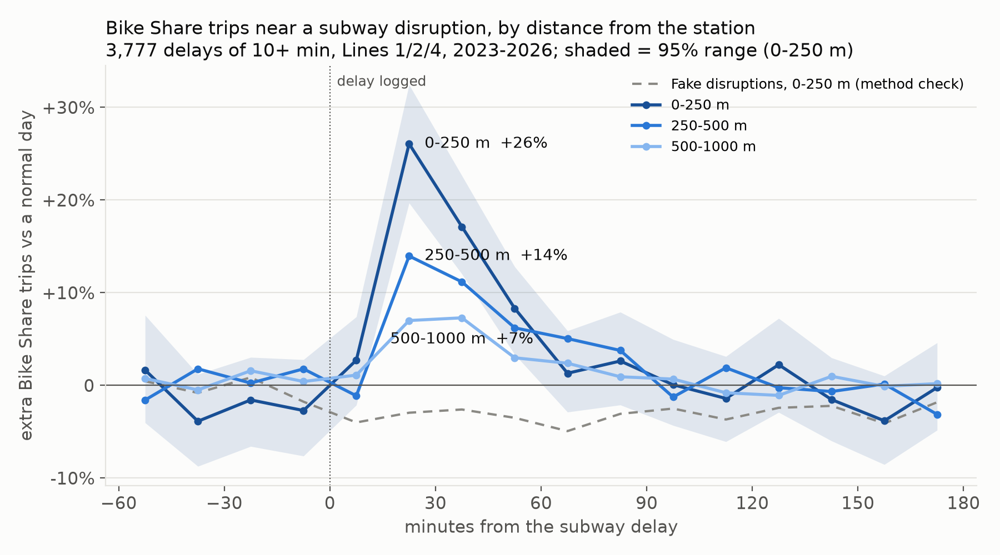
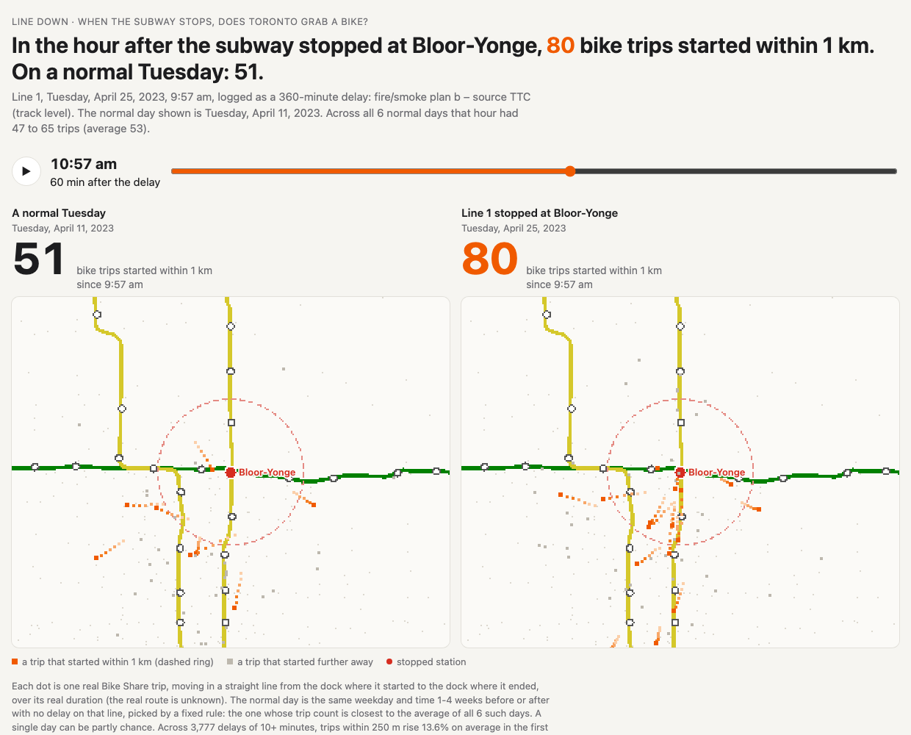

# Line Down

[](https://github.com/slmens/line-down/actions/workflows/tests.yml) [](LICENSE)

Watches Toronto's transport network and measures what happens when part of it fails. The core case: when a subway line goes down, where do people go, and can it be predicted as it happens?



[](https://slmens.github.io/line-down/)

*Above: the effect over time, and the [pixel map](https://slmens.github.io/line-down/) replaying one real disruption next to a normal day.*

## The finding

**When the subway stops, people walk to Bike Share, but only a few of them.** In the first hour after a 10+ minute subway delay, Bike Share trips starting within 250 m of the affected stations rise **+13.6%** (95% range +9.9% to +17.3%) above a normal day, fading to +7.5% at 250-500 m. That's about 0.7 extra trips per disruption next to the station. Bigger delays, bigger effect: +33% for 20-59 minute delays.

3,777 delays, Feb 2023 to Aug 2026, difference-in-differences against matched normal days, with a fake-event placebo that stays flat. Full write-up: [analysis/FINDING.md](analysis/FINDING.md).

## What's in it

| Part | Result | Write-up |
|---|---|---|
| Live collectors | TTC alerts and Bike Share dock levels every 30 s, unattended, with stale-feed alerts | `collectors/` |
| Warehouse | 45M trips, 270k delays; rebuilds from raw files with one command, identical every time; 41 data tests | `warehouse/` |
| Disruption finding | Above | [FINDING.md](analysis/FINDING.md) |
| Delay-length model | MAE 3.88 min vs 4.01 for the per-cause baseline: barely better, said plainly | [DELAY_LENGTH.md](models/DELAY_LENGTH.md) |
| Walk-or-wait advisor | Beats always-wait, always-bike and always-walk on held-out 2022 | [WALK_OR_WAIT.md](models/WALK_OR_WAIT.md) |
| Incident brief agent | A short brief for each live disruption; every number checked against our own facts (18 of 18 faithful so far) | [AGENT.md](agent/AGENT.md) |
| Pixel map | Replays real disruptions next to a normal day, trip by trip | `map/` |
| Dashboards | Tableau Public, from CSV extracts | [TABLEAU.md](bi/TABLEAU.md) |

## How it fits together

```
TTC alerts ┐                     ┌─► brief agent (every minute)
Bike Share ┴─► collectors ─► data/raw ◄── Toronto Open Data (weekly)
  (launchd, every 30 s)              │
                                     ▼
              staging (Python) ─► dbt models + tests ─► DuckDB warehouse
                                                          │
                     finding · models · map · Tableau extracts
```

- **Collectors** run on macOS system Python, standard library only, under launchd: they keep collecting even if everything else is down.
- **dbt** builds the warehouse tables from SQL and tests them ([warehouse/dbt/](warehouse/dbt/)).
- **Dagster** runs the pipeline on a schedule and shows its lineage and run history at http://127.0.0.1:3000 ([orchestration/](orchestration/)).
- Design decisions, each with its date and reason, are in [CLAUDE.md](CLAUDE.md#decisions).

## Run it

Needs macOS, [uv](https://docs.astral.sh/uv/), and about 16 GB RAM for the warehouse build.

```bash
~/.local/bin/uv python install 3.12 && ~/.local/bin/uv venv --python 3.12 .venv && ~/.local/bin/uv pip install --python .venv/bin/python -r requirements.txt
python3 pipelines/download_history.py          # history from Toronto Open Data
.venv/bin/python warehouse/build.py            # warehouse, about 75 s
.venv/bin/python analysis/disruption_effect.py && .venv/bin/python analysis/plot_effect.py
.venv/bin/python -m unittest                   # tests
sh collectors/install_launchd.sh               # collectors, brief agent and Dagster, always on
```

Every command is listed in [CLAUDE.md](CLAUDE.md#commands).

## Not done yet

Waiting on data (live collection began 2026-11-10):

- **Dock predictions**: which docks near a disruption will run empty. Needs a few weeks of live dock history to train and test on.
- **Live layer on the map**: today's disruptions and dock levels, not only past replays. Needs the same live history.
- **Agent accuracy over a real sample**: 18 incidents is too few to judge its length estimate; rescore after a few weeks (`agent/brief.py score`), and measure how alert duration differs from delay-log length.

Waiting on hands:

- **Tableau dashboards**: the extracts and the design are ready ([bi/TABLEAU.md](bi/TABLEAU.md)); the four dashboards still need building and publishing, and their link added here.

Later phase:

- **Highways and traffic cameras**, attached to the same pipeline.

Known limits: the map's single-day replays have no citywide control (the averaged finding does, so a single day can be partly chance); walk-or-wait assumes bikes are available until dock history exists; the data fits on one machine, so nothing here is tested at scale.

## Data credit and licence

Code: [MIT](LICENSE). The data is not ours and is not in this repository; the pipeline downloads it.

- **Subway delays, station locations (GTFS):** Toronto Transit Commission (TTC), published on [Toronto Open Data](https://open.toronto.ca) under the Open Government Licence – Toronto.
- **Bike Share trips:** Bike Share Toronto, published on Toronto Open Data.
- **Live feeds:** TTC alerts (`alerts.ttc.ca`) and the Bike Share Toronto GBFS feed. Dock-level history is our own snapshots of that feed.

Not affiliated with or endorsed by the City of Toronto, the TTC or Bike Share Toronto. Check each publisher's current terms before reusing their data.
