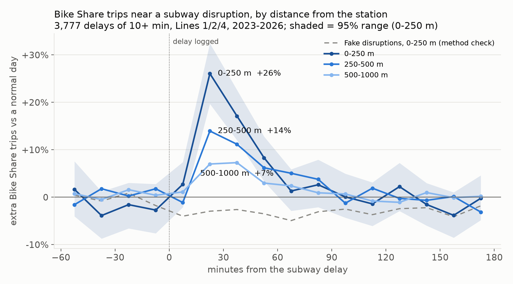
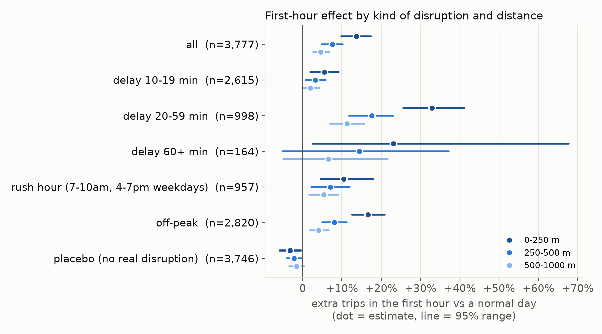

# When the subway stops, people walk to Bike Share, but only a few of them

*Line Down, first finding. Data: TTC subway delay log and Bike Share Toronto trips, Feb 2023 to Aug 2026. Reproduce with `.venv/bin/python analysis/disruption_effect.py` then `analysis/plot_effect.py` (about 10 seconds, after `warehouse/build.py`).*

## Result

In the first hour after a subway delay of 10+ minutes, Bike Share trips starting near the affected stations rise above a normal day. The rise is largest next to the station and fades with distance:

| Distance from affected station | Extra trips, first hour | 95% range | Normal trips in that hour (per event) |
|---|---|---|---|
| 0-250 m | **+13.6%** | +9.9% to +17.3% | 5.1 |
| 250-500 m | **+7.5%** | +4.9% to +10.2% | 9.6 |
| 500-1000 m | **+4.6%** | +2.7% to +6.7% | 31.9 |

- **It starts 15 minutes after the delay is logged and peaks at 15-30 minutes**: +26% within 250 m, +14% at 250-500 m, +7% at 500-1000 m.
- **It is over in about an hour.** By 60-75 minutes every ring is back within noise of normal.
- **Bigger delays, bigger effect.** 20-59 minute delays: +33% within 250 m (+26% to +41%). 10-19 minute delays: +5.6% (+2.0% to +9.2%). 60+ minute delays: +23%, but only 164 events, so the range is wide (+2.5% to +68%) and we can't say whether it's larger or smaller than 20-59.
- **Off-peak (+16.6%) shows a larger relative rise than rush hour (+10.5%)** within 250 m; the ranges overlap. One possible reason is that docks run empty at rush hour, which caps trips. Trip data cannot show that; the live dock feed can.

## In plain numbers

The percentages are of small numbers. A typical event has about 5 trips starting within 250 m in the hour after. **+13.6% is roughly 0.7 extra trips per disruption within 250 m, and about 3 extra trips within 1 km.** For a 20-59 minute delay it is about 1.7 extra trips within 250 m. Most stranded riders do something else: wait, take the shuttle bus, walk, or take a taxi. Bike Share absorbs a real but small share.

## How it was measured

- **Events:** 3,777 subway delays of 10+ minutes on Lines 1, 2 and 4 with a known station, 6am-11pm. Delays on the same line within 30 minutes count as one event. A delay logged "X TO Y" covers every station between X and Y.
- **Normal day:** the same stations, same weekday and clock time, 1-4 weeks before and after, skipping days with a disruption on the same line within 3 hours. At least 3 clean days are required.
- **Citywide swings removed:** each change is divided by the same change at stations more than 2 km away, so weather, holidays and events cancel out (difference-in-differences).
- **Uncertainty:** 95% ranges from 1,000 bootstrap resamples of the events.

## Checks

- **Before the delay, the lines are flat** (within about ±4% in every ring). Nothing anticipates the event, which is what a real effect looks like.
- **Fake disruptions show no spike.** The same method run on 3,746 fake events (each real event moved 5-9 weeks to a time with no disruption on that line) gives a flat −2 to −3% throughout. That's a small constant offset: baseline days run slightly busy, probably because they still contain sub-10-minute delays. So the real effect is, if anything, about 2-3 points larger than reported.

## Limits

- **"Minutes of delay" is not minutes of outage.** The log records how late a train was, and when the delay was logged, not exactly when service stopped.
- **Trips undercount demand.** An empty dock turns riders away and leaves no trace in trip data, so these numbers are a floor. The live dock feed (collected since 2026-11-10) will show this directly.
- **Only stations that exist today.** Bike stations are located from today's station list (96-99% of trips since 2023).
- **Not causal beyond the design.** Something that coincides with disruptions *and* happens only near those stations (e.g. a street closure at the same moment) would also show up here. The flat before-period and the fake-event test make this unlikely to explain the result.
